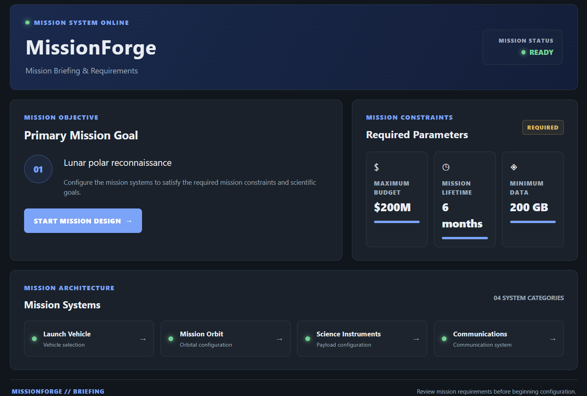
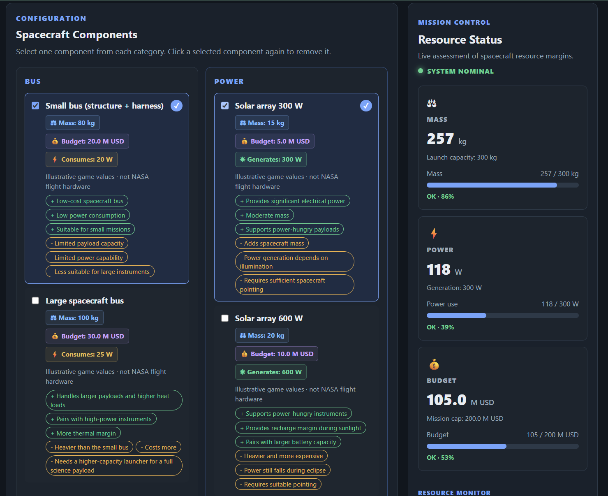
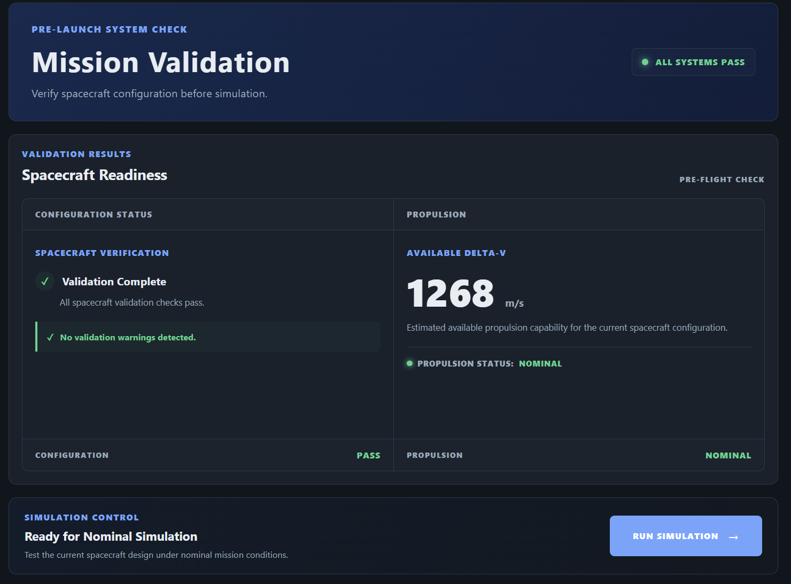
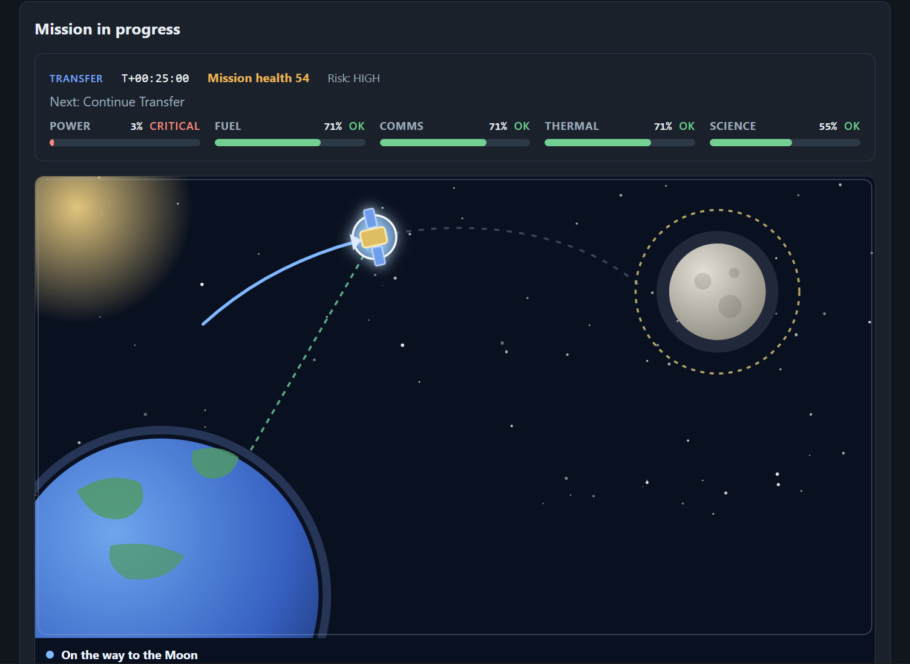
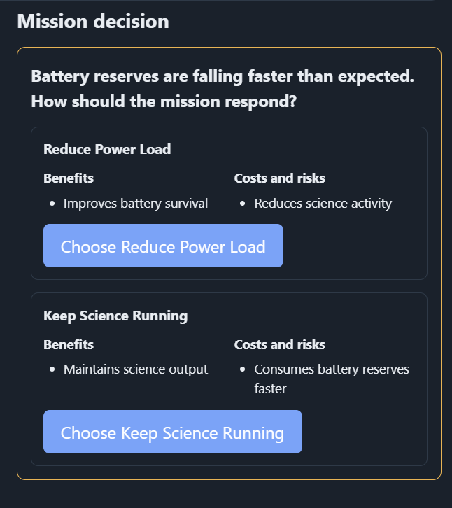
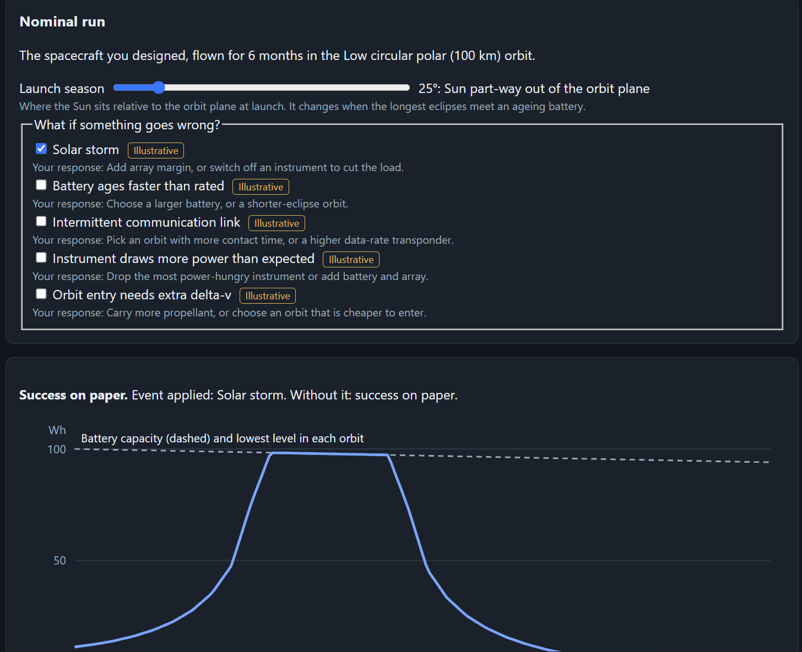
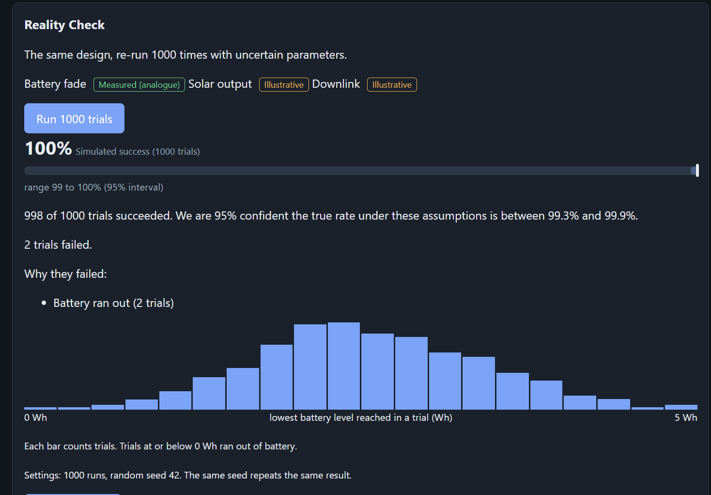
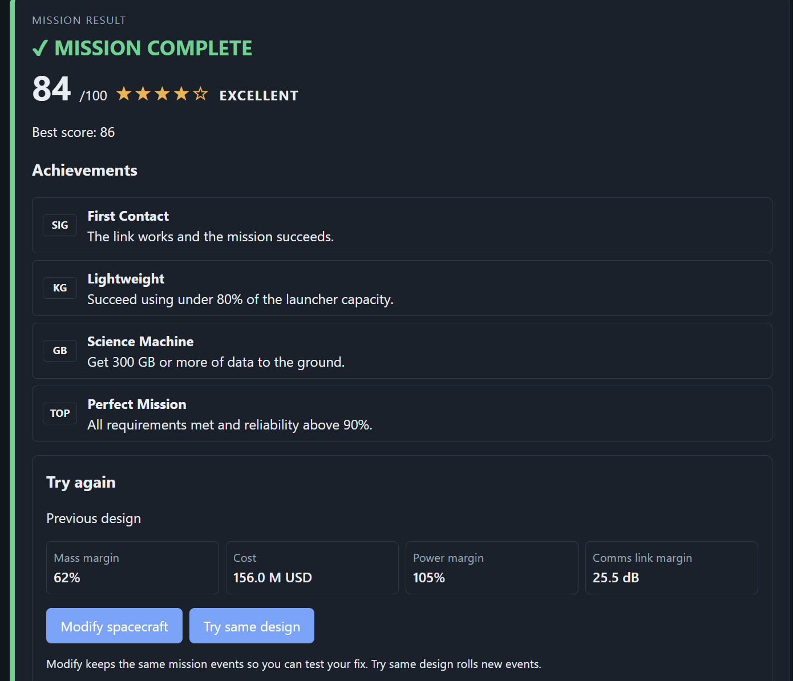
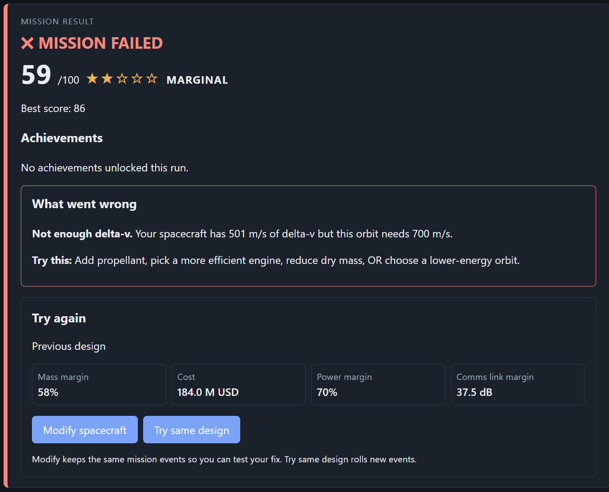

<div align="center">

# MissionForge

### Design a lunar mission. Launch it. Find out whether it survives reality.

**An interactive, uncertainty-aware space mission design game built for the NASA Space Apps Challenge 2026.**

<p>
  <a href="https://missionforge-4mdk.onrender.com/">
    
  </a>
  <a href="https://drive.google.com/file/d/1BJyttYpQetq2wy4VYH10xmG0QphSkhoA/view?usp=drive_link">
    
  </a>
</p>


</div>

---

## Why MissionForge?

A spacecraft can look perfect on paper and still fail in space.

A battery may degrade faster than expected. Solar output may fluctuate. A communications link may perform below its planned capacity. Real mission design is not just about finding a configuration that works under ideal conditions — it is about building one that can handle uncertainty.

**MissionForge turns that challenge into a playable mission-design experience.**

You choose the mission requirements, assemble a spacecraft, select an orbit and launcher, validate your design, and launch. Then you put your design through a **Reality Check: 1,000 Monte Carlo simulations** that introduce uncertainty into key mission parameters.

The game gives you two perspectives:

| Simulation | What it tells you |
|---|---|
| **Nominal run** | Does your design work when everything follows the plan? |
| **Reality Check** | How consistently does it work when battery degradation, solar output, and downlink performance vary? |

A design that succeeds in the nominal run but struggles under uncertainty has a problem worth investigating. MissionForge explains what went wrong and gives you clues about what to improve.

## Play in 60 seconds

**[Launch MissionForge](https://missionforge-4mdk.onrender.com/)** and try this first run:

1. **Read the briefing.** Check the mission objective and its budget, lifetime, and minimum-data requirements.
2. **Build your spacecraft.** The starter design is deliberately marginal and may run out of battery. Try the **600 W solar array** and **200 Wh battery**, then watch the health HUD respond to your choices.
3. **Validate your design.** Resolve compatibility and feasibility warnings before committing to launch.
4. **Launch the mission.** Follow the mission phases, respond to unexpected events, and weigh the trade-offs in each crisis decision.
5. **Run the Reality Check.** Test your design against 1,000 seeded trials. This result contributes to your score.
6. **Review your report.** Explore your score, stars, achievements, and closest real-mission match. Choose **Modify spacecraft** to iterate and try again.

<br>

## See it in action

  <a href="https://drive.google.com/file/d/1BJyttYpQetq2wy4VYH10xmG0QphSkhoA/view?usp=drive_link"><strong>Watch the full demo video →</strong></a>
</p>

<br>

## Screenshots

  <p><strong>1. Briefing</strong><br><sub>Understand the objective and mission requirements before designing.</sub></p>
  
  <p><strong>2. Spacecraft designer</strong><br><sub>Choose spacecraft components, an orbit, and a launch vehicle while monitoring mission health.</sub></p> 
      
  
  <p><strong>3. Validation</strong><br><sub>Check component compatibility and mission constraints before launch.</sub></p>
      
    
 <p><strong>4. Launch</strong><br><sub>Follow the mission as its phases and timed events unfold.</sub></p> 
    

<p><strong>5. Crisis decisions</strong><br><sub>Compare the benefits and risks of each response.</sub></p>  
      

<p><strong>6. Mission analysis</strong><br><sub>Inspect battery levels and eclipse periods throughout the mission.</sub></p>      
      

    
<p><strong>7. Reality Check</strong><br><sub>Explore the results of 1,000 seeded simulations with uncertain parameters.</sub></p> 
      

 <p><strong>8. Mission report</strong><br><sub>See your final score, stars, and achievements.</sub></p>
    

<p><strong>9. Failure analysis</strong><br><sub>Find out why a mission failed and what you could change.</sub></p>   
  


## What can you do?

### Design, validate, and fly

- Select spacecraft components, science instruments, lunar orbit, and launch vehicle.
- Track mass, power, battery, data, communications, cost, and mission time.
- Check launcher capacity, power through eclipse, communications link margin, and delta-v before launch.
- Play through five mission phases: launch, separation, transfer, orbit insertion, and science operations.

### Make decisions under pressure

Missions do not always go according to plan. MissionForge includes five possible random events:

- Solar storm
- Battery degradation
- Communications outage
- Instrument power spike
- Additional orbit-entry maneuver

When a crisis occurs, choose how to respond. Four decision scenarios present explicit trade-offs — for example, entering Safe Mode may protect the spacecraft but interrupt science operations.

### Test how robust your design is

The Reality Check runs **1,000 seeded Monte Carlo trials**. It varies selected mission parameters, including:

- Battery capacity fade
- Solar power output
- Communications downlink performance

The same seed reproduces the same result, making it possible to compare design changes consistently. The results help reveal whether your spacecraft has enough margin to tolerate variation.


### Learn from the outcome

Every mission ends with a report that includes:

- A score out of 100 and a 1–5 star rating
- Six achievements
- Resource and performance results
- A post-mortem explaining failures such as battery, delta-v, data, thermal, or orbit problems
- A comparison with the closest matching real lunar mission

Progress — including best score, achievements, and recent attempts — is saved in the browser.


## Real data, not just realistic-looking numbers

MissionForge uses published datasets and technical references to inform specific parts of the simulation. Each source has a defined purpose.

| Data source | Provider | How it is used |
|---|---|---|
| Battery Data Set (Saha and Goebel, 2007) | NASA Ames Prognostics Center of Excellence | Variation in capacity fade across four lab cells (B0005, B0006, B0007, B0018) informs battery uncertainty in the Reality Check. |
| Moon Fact Sheet | NASA NSSDCA | Lunar gravitational parameter, radius, and solar irradiance feed orbit and power calculations. |
| LRO, Lunar Prospector, and KPLO records and press kits | NASA; KARI for KPLO | Provides real-mission masses, orbits, lifetimes, and instruments for mission comparisons. |
| LRO delta-v budget (Folta, NASA GSFC, 2004) | NASA Goddard Space Flight Center | Provides a representative insertion delta-v for the 100 km orbit. |
| *Small Spacecraft Communications: State of the Art* | NASA Small Spacecraft Systems Virtual Institute | Informs the S-band and X-band frequencies used on communications cards. |

Orbit periods and eclipse tables are calculated by MissionForge's own code using published lunar constants:

- `js/sim/orbital.js`
- `scripts/derive_orbits.mjs`

### Know where each number comes from

Every number is marked with a provenance badge so players can distinguish source data from calculations and game-design assumptions.

| Badge | Meaning |
|---|---|
| `PUBLISHED` | Taken from a cited source. |
| `CALCULATED` | Computed by MissionForge using published constants. |
| `MEASURED` | Derived by the team from a real dataset. |
| `ILLUSTRATIVE` | A team assumption or game-design choice. |

For source URLs, access dates, and limitations, see **[`docs/data_sources.md`](docs/data_sources.md)**.


## Technical approach

MissionForge is built with **HTML, CSS, and vanilla JavaScript**. It uses native ES modules, with no frontend framework, bundler, or build step.

A few design choices shape the implementation:

- **Data-driven content:** Hardware, events, achievements, and other game content live in JSON, making them easier to tune without changing simulation code.
- **Separation of concerns:** Mission calculations, simulation, uncertainty modelling, game logic, and UI are organized into separate modules.
- **Offline analysis:** Heavier data-fitting and derivation tasks run through scripts. Their resulting data is shipped to the browser.
- **Reproducible trials:** Seeded random-number generation allows the same design and seed to reproduce the same Reality Check results.

## Run locally

You do not need to install dependencies or run a build command. However, the app must be served over HTTP because it loads JSON using `fetch`. Opening `index.html` directly with `file://` will not work.

### 1. Clone the repository

```bash
git clone https://github.com/YOUR-USERNAME/MissionForge.git
cd MissionForge
```

Replace `YOUR-USERNAME` with the repository owner's GitHub username.

### 2. Start a local server

Using Python:

```bash
python -m http.server 8000
```

Alternatively, use `npx serve` or the **Live Server** extension in Visual Studio Code.

### 3. Open the game

Visit **http://localhost:8000** in your browser.

## Run the tests

Start the local server first.

**Browser test suite**

Open:

```text
http://localhost:8000/tests/test.html
```

The browser suite contains 150+ checks covering the core logic, simulation, game layer, launch UI, and HUD health.

**Real-mission matching tests**

Run from the project root:

```bash
node tests/mission_match_tests.js
```

## Rebuild derived data

These scripts are for offline analysis and data generation; they are not required to play the game.

```bash
# Recalculate orbit periods and eclipse tables
node scripts/derive_orbits.mjs

# Fit battery fade data from NASA PCoE .mat files
python scripts/pcoe_fit.py
```

The battery-fitting script requires `numpy`, `scipy`, and the relevant B00xx `.mat` files.

## Project structure

```text
MissionForge/
├── index.html
├── css/                      # Screen styles
├── data/                     # JSON: components, orbits, missions, events,
│                             # decisions, phases, uncertainty, constants, achievements
├── docs/
│   ├── data_sources.md       # Sources, URLs, access dates, and limitations
│   └── screenshots/          # Images used in this README
├── js/
│   ├── main.js
│   ├── router.js
│   ├── state.js
│   ├── core/                 # Units, resources, propulsion, comms, validation, evaluation
│   ├── sim/                  # Orbital model, mission simulation, events, decisions,
│   │                         # mission run, and real-mission matching
│   ├── uncertainty/          # Seeded random-number generation and Monte Carlo
│   ├── game/                 # Health, trade-offs, achievements, failure analysis, saved progress
│   └── ui/                   # Screens, HUD, animated scene, gauges, decision cards
├── scripts/                  # Offline orbit derivation and battery-data fitting
└── tests/
```

## What's next?

Planned improvements include:

- Cross-checking orbit and eclipse tables against **GMAT**.
- Adding a **Mars Orbiter** mission. Other mission types are currently shown as locked previews.
- Expanding real-mission comparisons to include missions such as **LADEE** and **GRAIL**.
- Adding a leaderboard and shareable spacecraft-design links.

## Acknowledgements

MissionForge was built for the **NASA Space Apps Challenge 2026 — Space Mission Design Game**.

We are grateful to NASA and its partner agencies for making the datasets and technical documentation listed in [`docs/data_sources.md`](docs/data_sources.md) available. 

---

<div align="center">

**Build a mission. Test your assumptions. Learn from failure.**

<sub>MissionForge is an educational project and is not affiliated with, endorsed by, or officially connected to NASA.</sub>

</div>
